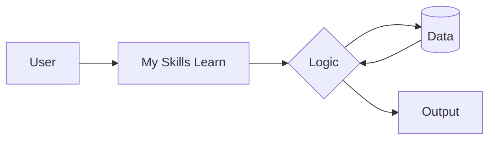

# My_Skills_Learn
In my two years of university life, I learned different skill-based topics such as SQL, Vue.js, prompt engineering, vibe coding, web development, and AI tool usage. These skills helped me improve my technical knowledge and prepare for modern software development.

## Architecture / How it Works

